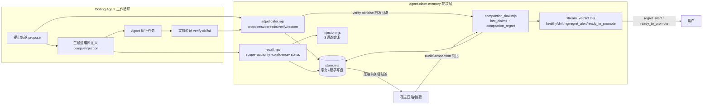

# agent-claim-memory

> 📖 架构与跨学科方法论总述：[`ARCHITECTURE_OVERVIEW.md`](./ARCHITECTURE_OVERVIEW.md)


通用的 **Agent 外置记忆裁决层 + 上下文压缩流审计仪**。零重型依赖：纯 Node.js ESM（`.mjs`），只用
`node:http`、`node:fs/promises`、`node:test`。不做 persona、不做情感陪聊、不做基于时间的遗忘——
结论只要没被证据推翻就永远有效，排序只服从工作四维：**scope × authority × confidence × status**。

## 为什么需要第 ③ 层裁决底座

Coding Agent 的上下文窗口有限，长会话迟早要压缩。压缩会带来三个具体的工程事故，不是抽象风险：

1. **细节丢失**：压缩摘要是人写的近似总结，不是原文；一条"stateRoot 必须是 `bots/<name>/state`"
   这样的硬约束很容易被压没，下一轮 Agent 直接写错代码。
2. **过时结论误导**：旧方案被新方案推翻后，如果旧结论还飘在上下文里，Agent 可能两头乱撞，交付
   自相矛盾的代码。
3. **不知道压缩好不好**：没有人在统计"这次压缩到底丢了什么、丢的东西后来有没有造成返工"，
   压缩质量全凭感觉。

第 ① 层是模型本身的上下文窗口，第 ② 层是宿主的压缩/摘要算法——这两层都不对"结论本身的真假与
时效性"负责。这个项目是独立于宿主之外的**第 ③ 层**：一个外置的、带裁决权的事实账本，专门回答
"这条结论现在还成立吗、证据是什么、压缩有没有把它丢了、丢了有没有造成后悔"。

## 架构闭环图



## 目录结构

```
src/
  schema.mjs           Claim schema（冻结 schema_version:1）+ 校验
  store.mjs            事务存储：namespace 分目录 + 原子写盘 + 崩溃自愈 + verifyIndexConsistency
  adjudicator.mjs       propose / checkAndSupersede / verifyClaim / restoreClaim（防双活 + 冷启动定位）
  recall.mjs            工作四维召回：真 IDF 加权 BM25（无时间衰减）
  injector.mjs          三通道编译注入（constraint / context / pitfall）+ Token 节省统计
  memory_policy.json     注入通道的静态策略（条数/字数上限、权威门槛）
  compaction_flow.mjs     压缩损失审计 + compaction_regret 因果回溯 + 四定义流评估
  stream_verdict.mjs      流 -> 人话大结论（healthy/drifting/regret_alert/ready_to_promote）
  memory_sdk.mjs          对外 SDK：createClaimMemory({ dataDir, namespace })
  server.mjs              纯 node:http 控制台 + API（127.0.0.1:3457）+ /api/demo/seed
  launch.mjs              控制台启动器（被 .bat 调用，自动打开浏览器）
  demo.mjs                20 轮真实工作流回放剧本（CLI + 供控制台"一键演示"复用）
public/
  index.html              控制台前端（无框架，纯 HTML/CSS/JS，含🎬演示按钮）
test/
  claim_memory.test.mjs   14 项 0 API 调用单测，os.tmpdir() 隔离
.github/workflows/ci.yml  CI：check + test + demo，并断言 data/ 无残留
双击打开记忆裁决控制台.bat   纯英文 CRLF 批处理，调用 src/launch.mjs 防止 cmd.exe 中文乱码
```

## 30 秒体验

```bash
npm test     # 14 项 0 API 调用单测
npm run demo  # 20 轮真实工作流回放，打印 Token 节省率 + regret_alert
npm start      # 启动控制台 http://127.0.0.1:3457，点🎬按钮看完整剧本
```

`npm run demo` 的真实输出（2025 年实测，数字会随 claim 文本小幅波动但量级稳定）：

```
Token 节省率 (round 7 三通道编译 vs 全量): 92.9%
第一次压缩 (优质) lost_claims: 0  -> verdict: healthy
第二次压缩 (拙劣) lost_claims: 5  (stateRoot约束、Windows踩坑、技术方案、锁约束、import踩坑)
压缩后立即召回救回的结论: 4 条（scope 命中 src/agent.js 的全部救回）
踩坑后 stream_verdict: regret_alert
最终 stream_verdict: regret_alert
索引一致性: true
四定义压缩流评分: learning_index=0.4 trust_score=0.5 weight_quota=0 proficiency=0
```

## 核心设计

### 工作四维，无时间衰减
召回排序公式：`scope_match × bm25 × authority_weight × confidence × utility × status_weight`。
`bm25` 现在是**真正的 IDF 加权 BM25**（标准 Robertson/Sparck-Jones 公式，`k1=1.5, b=0.75`），
IDF 基于当前 namespace 的活跃结论实时计算——"文件"、"修改"这类十条结论里出现九次的水词 IDF
趋近于 0，而一个只出现在一条结论里的报错码（如 `ERR_MODULE_NOT_FOUND`）IDF 权重高，精准压过
水词噪音。`cooldown_factor` 固定为 `1`——显式保留此项只是为了在公式里标注"本系统没有时间淘汰"，
不是留了一个未实现的衰减钩子。90 天前的 `active` 决策与 1 小时前的一样可召回。

### 事务与防死锁
`store.transaction(async tx => {...})` 是唯一获取锁的入口。锁内部只暴露无锁的 `tx.*` 方法
（`addClaim` / `updateClaim` / `getClaim` / `listClaims` / `addCompactionEvent` / `appendRegret`），
它们直接操作内存索引，不重新获取锁。`adjudicator.mjs` 的每个公开方法（`proposeClaim` /
`verifyClaim` / `restoreClaim`）内部只开一次 `transaction()`；跨事务的级联调用（例如
`verifyClaim` 触发 `compaction_regret` 回溯）严格放在上一个事务 **提交并释放锁之后** 再发起新事务。

### 崩溃自愈与损坏行容错
`readJsonlTolerant()` 逐行解析 `claims.jsonl` / `compactions.jsonl`：只有「最后一行且没有结尾
换行符」解析失败时才判定为"进程被杀导致的半截写入"并安全丢弃，其余任何位置的损坏行都单独上报
（不会被静默吃掉，也不会让整个文件加载失败）。冷启动加载时，`claim_index.json` 永远只当缓存：
缺失、损坏、或其中结论条数与 `claims.jsonl` 重放结果不一致，都会触发**以日志为唯一真相源的自动
重建**，并立刻把修复后的索引原子写回磁盘，防止同一个修复扫描在下次重启时重复发生。日志中一旦
durably append 过的结论，永远不会因为索引缓存损坏而丢失。

### 冷重启也能按 block_id 精确定位
`verifyClaim(blockId, { namespace })` / `restoreClaim(blockId, { namespace })` 在开事务前会先
确保目标 namespace 已从磁盘加载；不传 `namespace` 时会扫描 `data/namespaces/*` 逐个加载直到命中。
`memory_sdk.mjs` 的 `verify`/`restore` 默认带上实例自身的 namespace，日常调用不需要关心这个细节；
需要跨 namespace 操作时仍可显式传入。这修复了上一轮遗留的"全新进程下按裸 `block_id` 直接验证/翻案
历史结论会报 not found"的问题。

### 防全量重扫爆炸
一次事务内对同一 namespace 的多次增删改只patch内存中的 `claimsById` / `claimLog` /
`compactions`，事务提交时才对该 namespace 写盘一次：`claims.jsonl`、`compactions.jsonl`、
`claim_index.json` 均走 `.tmp` 临时文件 + `rename` 原子替换。`verifyIndexConsistency(namespace)`
从磁盘重放 `claims.jsonl` 并与内存索引逐条 diff，用于离线对账。

### 三通道互不打架
- **channel 1 `compiled_constraints`**：只收 `kind === 'constraint'` 且权威 ≥
  `tool_verified`、置信 ≥ 0.6 的结论，最多 3 条、每条 ≤ 30 字。
- **channel 2 `context_claims`**：`decision` / `api_shape` / `todo`，命中当前 `scope` 才注入。
- **channel 3 `pitfall_warnings`**：命中当前文件/工具的 `pitfall`，高优先级单独列出。
- `debugTrace` 给出每条结论的打分拆解和相对"全量记忆原文转储"的字符/Token 节省比例
  （真实剧本回放中稳定在 90%+）。

### `restore` 严格防双活
- `archived` → 直接恢复 `active`。
- `superseded` → 必须显式传 `mode`：`replace_current`（反覆盖）或 `mark_disputed`（双方同时
  `disputed`），绝不让互斥结论同时 `active`。

### `compaction_regret` 因果回溯
`auditCompaction` 比对压缩前关键结论与摘要文本，记录 `lost_claims`。之后任何
`verifyClaim(id, { ok:false, currentRound })` 失败时，会在最近 `windowRounds`（默认 10）内查找
作用域重叠的 `lost_claims`，命中则把一笔 `compaction_regret` 记录追加到对应压缩事件，供
`evaluateCompactionFlow` 计算可信度，也供 `stream_verdict` 升级为 `regret_alert`。

### 四种人话大结论
`stream_verdict.getVerdict()` 优先级：`regret_alert` > `drifting` > `ready_to_promote` >
`healthy`。

## 集成到 DSH / 任意 Coding Agent

```js
import { createClaimMemory } from './src/memory_sdk.mjs';

const mem = createClaimMemory({ dataDir: './data', namespace: 'my-project' });

await mem.propose({
  kind: 'constraint',
  claim: 'store.transaction 内部禁止重入写锁',
  scope: { files: ['src/store.mjs'], modules: [], tags: ['store'] },
  source: { kind: 'user', ref: 'chat:2025-xx-xx' },
});

const injection = await mem.compileInjection(
  { taskText: '修改 store.mjs 的事务逻辑', activeFiles: ['src/store.mjs'] }
);

// 冷重启后依然可以直接按 block_id 操作：
await mem.verify('constraint_xxx', { ok: true, note: '审查确认无重入' });
```

## 已知边界

见会话汇报中的"遗留风险"章节，此处不重复。
